# Кот-экзорцист — прототип

Вертикальный idle-шутер: котик с пылесосом-деструктором чистит дома от призраков, а пойманные призраки воюют на его стороне.

Это играбельный прототип на чистом HTML5 Canvas, без зависимостей и сборки.

## Как запустить

- Открыть `index.html` в браузере (на телефоне или в режиме мобильного устройства в DevTools).
- Или включить GitHub Pages для ветки (Settings → Pages) и открыть ссылку с телефона.

## Что уже есть

- **Большие карты с видом сверху** (как в Vampire Survivors): каждая комната — карта 1100×1300, камера следует за котом и чуть отдалена. У каждого района свой пол и мебель (кровати, шкафы, ящики, бочки, надгробия), кот и призраки упираются в неё. Призраки лезут со всех сторон, до 14 одновременно и 22 за комнату; к боссу, золотому призраку и кристаллам за экраном ведут стрелки.

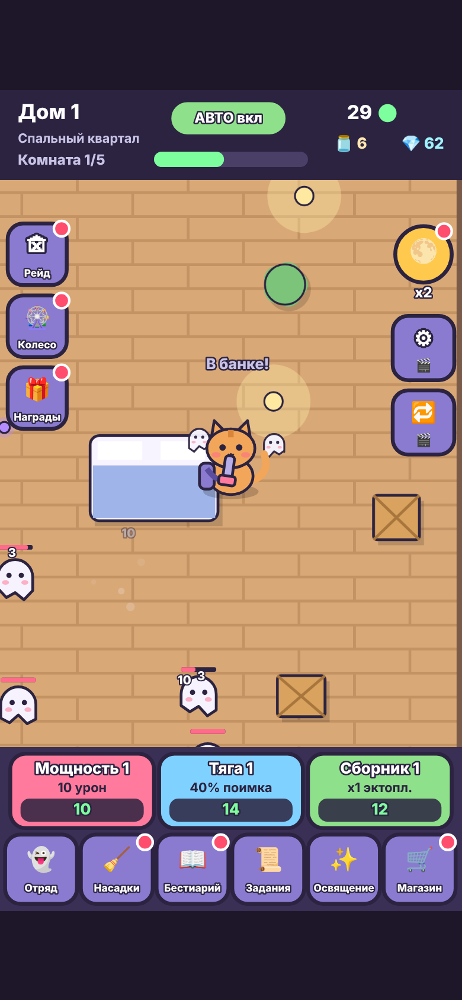

- **Края карты** у каждого района свои: кирпичные стены с окнами, каменная кладка с мхом, вода с причалом, витрины универмага с вывесками SALE, живая изгородь с кованой оградой. В углах колонны и паутина.
- **Графика:** объёмная заливка кота и призраков, блики, моргание, призраки смотрят на кота, тени на полу, шлейф и свечение, портал при появлении, лапки и бак с эктоплазмой у кота, светящийся луч и вспышка на сопле, полумрак дома со светом вокруг кота, пылинки в воздухе.

- **Интерфейс:** объёмные кнопки с градиентом, бликом и тенью, проседают при нажатии; пилюли ресурсов сверху, переключатель АВТО, полоса комнаты с отметками, анимированные полоски здоровья босса, окна с лентой-заголовком, карточки с тенью, пульсирующие значки, блик на доступных прокачках.
- **Музыка и звуки** синтезируются прямо в браузере (Web Audio), без файлов. У каждого района своя тема (шкатулка в спальном квартале, шанти в порту, лифтовая музыка в универмаге, колокола на кладбище), отдельные треки для босса и рейда. Около 25 звуков: выстрел, попадание, крит, засасывание, поимка, слияние, призыв, покупка, награда, колесо, золотой призрак, появление босса. Кнопки 🎵 и 🔊 слева на поле боя включают и выключают их, выбор сохраняется. Звук запускается после первого касания экрана (требование браузеров).
- **Объекты на карте** нарисованы в перспективе 3/4 с объёмом и тенями: кровати с лоскутным одеялом, диваны, столы с чашкой и рыбкой, коробки, книжные шкафы, рыцарские доспехи, сундуки, бочки, канаты, сети с поплавками, спасательные круги, якоря, вешалки с одеждой, манекены, надгробия с цветами, тыквы-фонари, свечи, деревья, разные лампы по районам. На карте до 30 объектов.
- **Скины кота: 19 штук на 5 уровнях.** Бонусы всех купленных скинов складываются, даже если скин не надет.
  - Обычные (150–300 💎, +6–8%): Рыжик (стартовый), Пятнышко, Полосатик в шапке, Персик-трёхцветка с цветком.
  - Редкие (600–900 💎, +10–20%): Уголёк, Снежок, сиамский Сапфир в наушниках, Капитан Мяу с повязкой и треуголкой.
  - Эпические (1200–2000 💎, открываются на домах 10/15/20/25): Ниндзя, волшебник Мурлин, повар Пирожок, Космокот в шлеме.
  - Легендарные (донат $2.99–4.99, +25–40%): Граф Мурракула, Чертёнок, ангел Пушинка, Дед Мурмороз.
  - Мифические (донат $9.99–12.99, +50–60%): Золотой кот, призрачный Фантом, и Кот-Жнец за 30-й уровень премиум-пропуска.
  В магазине вкладки по уровням со счётчиком собранного и суммарным бонусом коллекции.

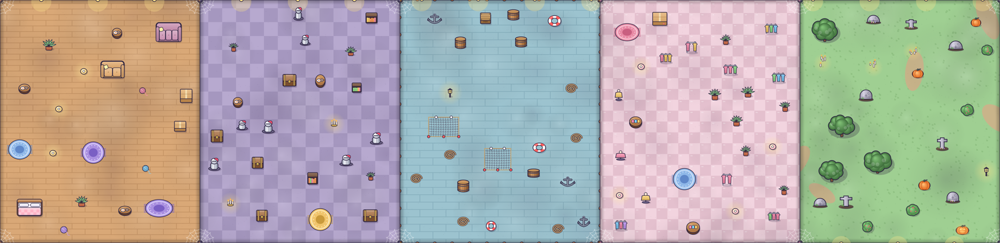
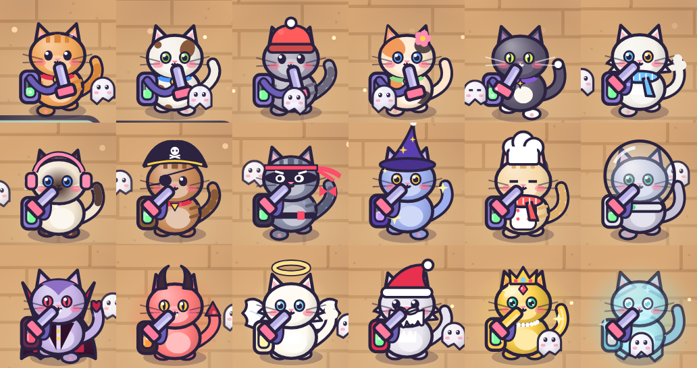
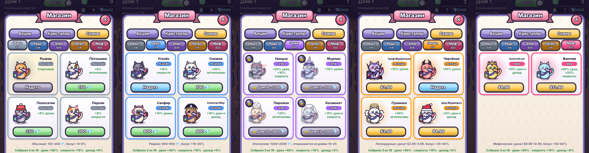
- **Колесо удачи, награды за вход и рейд** перерисованы: колесо с мигающими лампочками, иконками призов, подставкой и подсветкой выигрыша; карточки дней с отметками, «Сегодня», особым 7-м днём, прогрессом недели и таймером; рейд со сценой ночного особняка, иконками наград, билетами и таймером до новых. Иконки банки, кристалла, луны, насадки, короны, билета нарисованы кодом, потому что эмодзи 🫙 на части устройств не отображается.

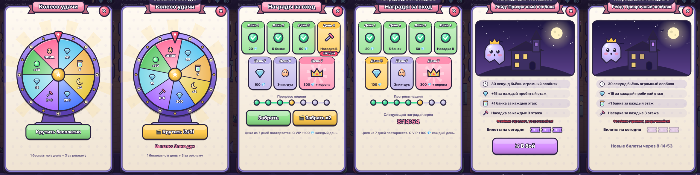

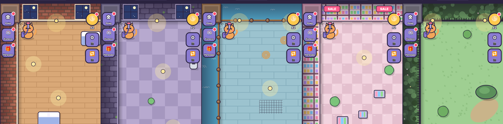
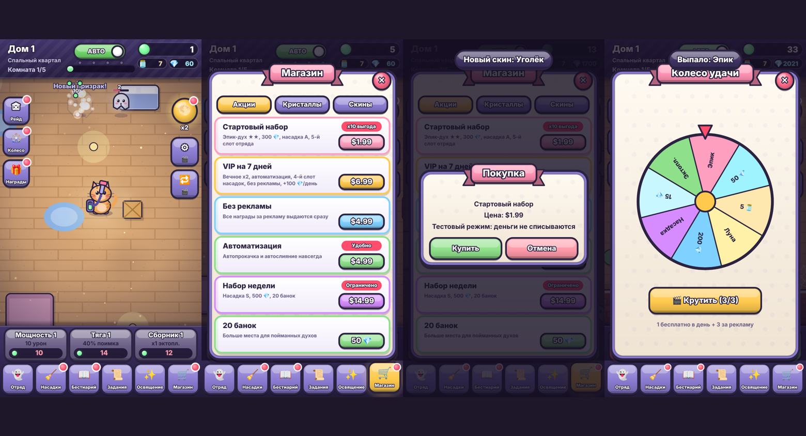
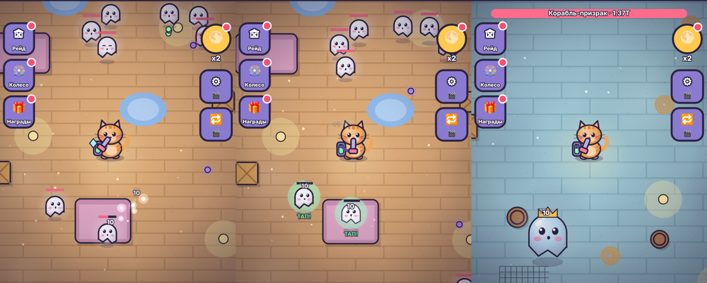

- **Управление.** Кот сам ходит и уворачивается (кнопка «АВТО» сверху), но в любой момент можно вести его свайпом по полю боя: появится джойстик. Через 2 с после отпускания снова включается автопилот.
- **Угрозы.** Призраки подлетают вплотную и пугают кота, редкие и боссы стреляют сгустками эктоплазмы. Шкала смелости под котом; если она опустеет, комната начнётся заново (в комнате босса — откат на шаг назад).
- **Осколки кристаллов** падают на пол, их нужно подобрать котом.
- **Автобой** лучом пылесоса, большие цифры урона, криты.
- **8 районов** по 10 домов: Спальный квартал, Старый город, Порт, Универмаг, Кладбище котов, а на высоких этапах Ледяной замок (51–60), Безумная лаборатория (61–70) и Лунный дворец (71–80). У каждого свои 3 призрака и босс (всего 32 вида). После дома 80 город начинается заново как «Круг 2» с более сильными призраками и x2 💎 с боссов.
- **Дом:** 5 комнат, последняя с боссом и таймером 30 с (до 50 с с талантом).
- **Поимка:** ослабленный призрак светится, тап засасывает его в банку.
- **Отряд** из 4 призраков (5-й слот на доме 15, ещё один в стартовом наборе), слияние 3 → +1 звезда (до 7★ с дома 40). Синергия: 2 духа одного района дают +20%, 4 дают сет-бонус.
- **Насадки пылесоса:** призыв за кристаллы (x1 / x10), ранги D…S (SS и SSS с дома 30), слияние 3 → ранг выше, 3 слота (4-й на доме 25, ещё один с VIP). Узкая пробивает, Широкая задевает соседей, Турбо взрывается каждый 5-й выстрел, Лазерная щётка усиливает криты, Пылевые ракеты бьют сами.
- **Бестиарий:** вехи 1/10/50/200 поимок каждого вида дают кристаллы и +3% урона навсегда.
- **Задания:** 3 активных, после выполнения заменяются новыми, посложнее.
- **Освящение (престиж)** с дома 10: сброс домов и прокачки за лунные камни. Каждый заработанный камень навсегда даёт +5% урона и +2% дохода, а свободные камни тратятся в **Лунном алтаре** на 6 талантов: Мощь луны, Лунный урожай, Лунная память (старт с дальнего дома и часть уровней), Ночная смена, Кошачья удача, Песочные часы. За рекламу освящение даёт +50% камней.
- **Новая математика:** здоровье призраков растёт быстрее награды, поэтому без освящения прогресс упирается в стену около дома 15, а дома 51–80 становятся эндгеймом. Формулы, таланты и симуляция по забегам в [docs/BALANCE.md](docs/BALANCE.md), симулятор в `tools/balance-sim.js`.
- **Путь открытий:** колесо с дома 3, рейды с 5, освящение с 10, слот отряда с 15, элитные призраки с 20, слот насадок с 25, ранги SS/SSS с 30, 7 звёзд с 40, новые районы с 51/61/71, «Круг 2» с 81. Каждое открытие показывает окно «Открыто!», весь список во вкладке «Путь».
- **Элитные призраки** (с дома 20): золотое сияние и корона, x6 здоровья и эктоплазмы, +2 💎.
- **Ежедневные задания:** 5 случайных заданий в день и сундук за все 5. **Серия входов** умножает их награды на x1.1 за каждый день подряд (до x2), с 7 дней в сундуке насадка A; пропуск дня сбрасывает серию.
- **Призрачный пропуск:** 30 уровней, сезон 28 дней, опыт за задания дня, сундук, боссов, рейды и колесо. Бесплатная дорожка и премиум за $4.99 с лунными камнями, насадками S и мифическим скином «Кот-Жнец». Уровень можно докупить за 100 💎, VIP даёт +50% опыта.

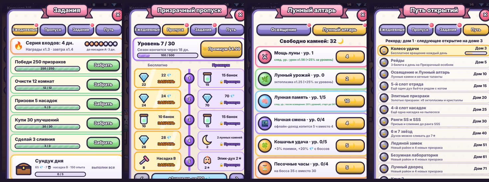
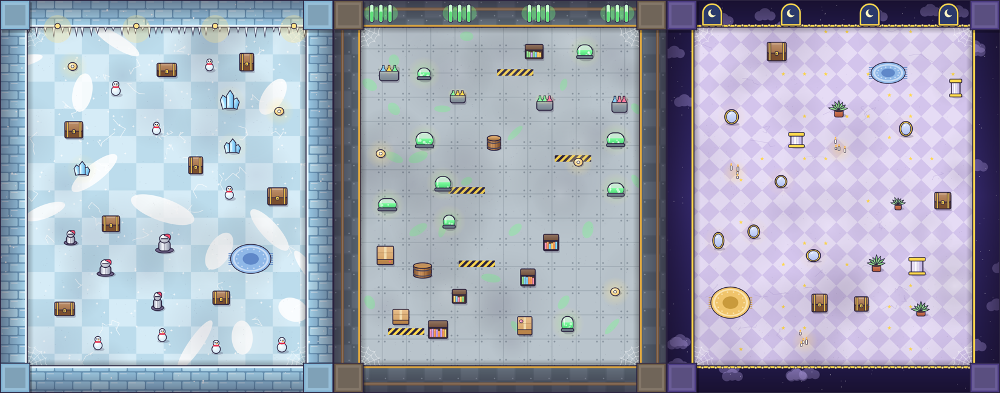
- **Три прокачки:** Мощность, Тяга, Сборник.
- **Полнолуние** x2 на 60 с (заглушка под rewarded-рекламу), сохранение, офлайн-доход до 4 ч (до 8 ч с талантом, +4 ч с VIP).

- **Рейд «Призрачный особняк»:** 3 билета в день, 30 с, каждый пробитый этаж даёт кристаллы и банки, каждые 3 этажа — насадку.
- **Колесо удачи:** 1 бесплатное вращение в день + 3 за рекламу.
- **Награды за вход:** цикл из 7 дней.
- **Золотой призрак** пролетает раз в 1–2 минуты: тап даёт эктоплазму, за рекламу x3.
- **Автопрокачка и автослияние** (кнопки ⚙ и 🔁 справа на поле боя): 10 минут за рекламу, навсегда за $2.99 каждая или $4.99 вместе, в VIP включены. Когда функция доступна, кнопка ставит её на паузу и снимает с паузы.
- **Магазин:** стартовый набор, VIP, Призрачный пропуск, Лунный ускоритель (x2 камней на 3 освящения, $2.99), «Без рекламы», набор недели, паки кристаллов, банки, скины.

## Реклама и покупки в прототипе

Это заглушки. Реклама показывает экран на 2,5 с и выдаёт награду; в релизе там будет вызов rewarded-видео (AdMob / AppLovin MAX / Unity Ads). Покупки открывают окно подтверждения и ничего не списывают; в релизе там будет Google Play Billing / App Store IAP. С VIP или «Без рекламы» награды выдаются сразу.

Точки rewarded-рекламы: автопрокачка и автослияние на 10 минут, Полнолуние x2, офлайн-доход x2, золотой призрак x3, +15 с и полная смелость в бою с боссом (1 раз за бой), бесплатный призыв насадки (раз в 4 ч), бесплатные 20 кристаллов (раз в час), +5 банок, вращения колеса, доп. билет рейда, x2 награда рейда, x2 награда дня, x2 сундук дня, +50% камней при освящении.

## Чего пока нет

Настоящие SDK рекламы и покупок, отдельные спрайты (сейчас всё рисуется кодом).

## Отладка

В консоли браузера: `__game.state()` — текущее состояние, `__game.reset()` — сброс прогресса, `__game.go(51)` — перейти на дом 51, `__game.info()` — урон, доход и здоровье призраков на текущем доме.

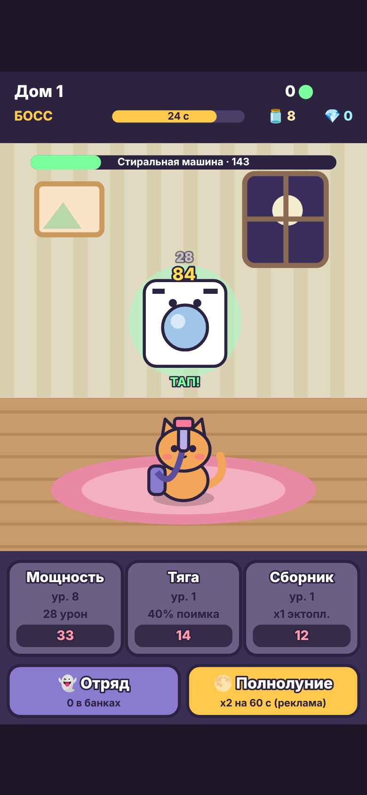
